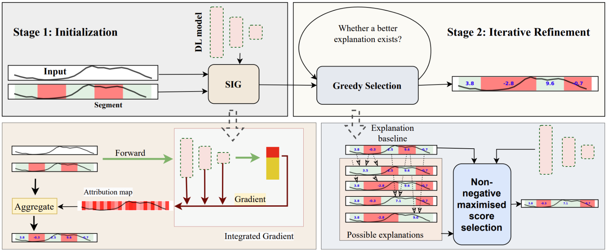
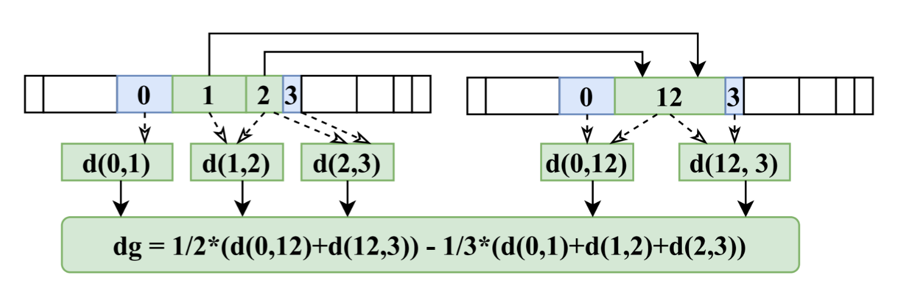
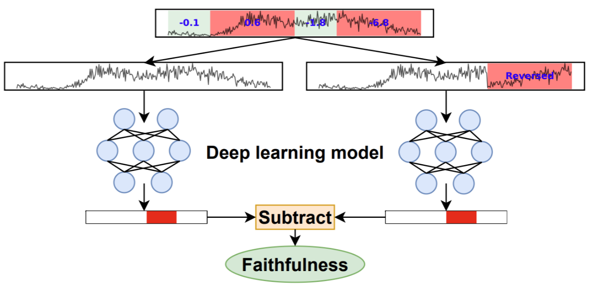

# InteDisUX: Interpretation-Guided Discriminative User-Centric Explanation for Time Series
This readme file is an outcome of the [CENG7880 (Fall 2026)](https://metu-trai.github.io/) project for reproducing a paper which does not have an implementation. See [CENG7880 (Fall 2026) Project List](https://github.com/metu-trai/Projects2026) for a complete list of all paper reproduction projects.

# 1. Introduction

"InteDisUX: Intepretation-Guided Discriminative User-Centric Explanation for Time Series" [1] was written by Viet-Hung Tran, Zichi Zhang, Tuan Dung Pham, Ngoc Phu Doan, Anh-Tuan Hoang, Peixin Li, Hans Vandierendonck, Ira Assent, and Son T. Mai and was published at AAAI 2025. The study focuses on explaining the decisions of deep learning models for time series classification (TSC) in a way that is both faithful to the model and understandable to humans. Most existing approaches use attribution maps, which assign a separate importance score to every time step, so the resulting explanations are long and hard for users to interpret. LIME-based methods [2, 4, 5] improve on this by splitting the series into segments, but they require a predetermined number of segments for every instance and inherit the shortcomings of LIME, such as instability, poor local fidelity, and sensitivity to imbalanced sampling. To address these issues, the authors propose a **segment-level** explanation method that does not rely on predefined segments. They first introduce Segment-level Integrated Gradients (SIG), which scores each segment by summing the Integrated Gradients [3] of its time steps and satisfies several axioms of model explanation at the segment level. Starting from small equal-length segments, their method then merges two consecutive segments at a time under a greedy strategy guided by two new metrics: discrimination gain, which favors segments that differ clearly from their neighbors, and faithfulness gain, which uses the model's own outputs to keep the explanation faithful. In essence, the number and location of segments are adapted to each instance and to the model being explained. As a result, they report more faithful explanations than LIME-based methods on all 12 datasets and more robust explanations on 8 of the 12 datasets.

The goal of this project is to implement the proposed InteDisUX method and to reproduce the results presented in the paper to evaluate its explanation quality. These results include the faithfulness and robustness scores on 12 UCR datasets averaged over five deep learning architectures (CNN, Transformer, FC, Dense-FCN, and LSTM-FCN), compared to the baseline LIME-based methods (Neves et al. [4], Guillemé et al. [5], and LIMESegment [2]). They also include the ablation studies that measure the separate contributions of SIG, the discrimination gain, and the faithfulness gain, as well as the effect of the initial number of segments on the explanation.

## 1.1. Paper summary

### 1.1.1. Motivation and Aim

Time series classification (TSC) is used in many practical domains such as healthcare, finance, and supply chain management. Deep learning (DL) models have become an effective approach for TSC because they learn relevant feature representations directly from the data. However, DL models are black boxes, which reduces their trustworthiness and makes it difficult to identify and correct their errors. Explainable AI (XAI) methods address this problem by explaining which parts of the input the model relies on.

Most existing XAI methods for time series produce attribution maps, which assign an importance score to every time step. A time series usually contains a large number of time points, so these maps are impractical for users to read. They also ignore the temporal correlations between neighbouring time steps, which is a key difference between time series and tabular data. To obtain explanations that are simpler and closer to human perception, LIME-based methods [2, 4, 5] split the time series into segments and assign an importance score to each segment with a LIME [6] surrogate model. However, these methods have two main problems. First, they require a predetermined number of segments, which is the same for every instance. For example, LIMESegment [2] always produces 3 segments in the authors' comparison. Second, they inherit the weaknesses of LIME:
- **Instability:** sample weights become very small for samples that are far from the explained instance, so the importance scores approach zero.
- **Poor local fidelity:** the generated samples are far from the explained instance, so they are not local.
- **Imbalanced sampling:** all generated samples may fall into a single class, which makes every segment's score zero after ridge regression.

To address these challenges, the authors propose InteDisUX, a segment-level explanation method that does not depend on predefined segments. The importance of each segment is computed with Segment-level Integrated Gradients (SIG), which is deterministic and does not require sampling, so it avoids the problems of LIME. Segments are found with a bottom-up strategy: the series is first divided into small equal segments, and then two consecutive segments are merged greedily. Each merge is guided by two new metrics:
- **Discrimination gain** measures how distinct consecutive segments become after the merge.
- **Faithfulness gain** uses the model's outputs to make sure that the merge does not make the explanation less faithful.

In this way, both the number and the locations of the segments are adapted to each instance and to the model being explained.

### 1.1.2. Datasets

All 12 datasets are univariate binary classification datasets from the UCR Time Series Archive [7]. They are the same datasets that were used in the LIMESegment [2] paper.

**[Coffee](https://www.timeseriesclassification.com/description.php?Dataset=Coffee)** [7]: Contains 56 food spectrograph samples (28 train, 28 test) of length 286. The task is to distinguish Arabica from Robusta coffee beans.

**[Strawberry](https://www.timeseriesclassification.com/description.php?Dataset=Strawberry)** [7]: Contains 983 infrared spectra (613 train, 370 test) of length 235 of fruit purees. The task is to classify purees as strawberry or non-strawberry (adulterated).

**[GunPointOldVersusYoung (GPAge)](https://www.timeseriesclassification.com/description.php?Dataset=GunPointOldVersusYoung)** [7]: Contains 451 samples (136 train, 315 test) of length 150. Each series is the x-coordinate of an actor's hand while drawing a replica gun from a holster. The task is to classify the actor as young or old.

**[GunPointMaleVersusFemale (GPGender)](https://www.timeseriesclassification.com/description.php?Dataset=GunPointMaleVersusFemale)** [7]: Contains 451 samples (135 train, 316 test) of length 150. It uses the same gun-drawing recordings as GPAge, and the task is to classify the actor's gender.

**[HandOutlines (Hand)](https://www.timeseriesclassification.com/description.php?Dataset=HandOutlines)** [7]: Contains 1,370 samples (1,000 train, 370 test) of length 2,709. The outline of a hand, extracted from an X-ray image, is converted into a one-dimensional series.

**[Yoga](https://www.timeseriesclassification.com/description.php?Dataset=Yoga)** [7]: Contains 3,300 samples (300 train, 3,000 test) of length 426. The outline of an actor performing yoga poses is converted into a one-dimensional series, and the task is to classify the actor (male or female).

**[ECG200 (ECG)](https://www.timeseriesclassification.com/description.php?Dataset=ECG200)** [7]: Contains 200 samples (100 train, 100 test) of length 96. Each series records the electrical activity of a single heartbeat, and the task is to distinguish normal heartbeats from myocardial infarction.

**[DodgerLoopGame (Dodger)](https://www.timeseriesclassification.com/description.php?Dataset=DodgerLoopGame)** [7]: Contains 158 samples (20 train, 138 test) of length 288. Each series is one day of traffic counts from a loop sensor near Dodger Stadium (Los Angeles), aggregated every 5 minutes. The task is to classify each day as a game day or a normal day.

**[Chinatown](https://www.timeseriesclassification.com/description.php?Dataset=Chinatown)** [7]: Contains 363 samples (20 train, 343 test) of length 24. Each series is one day of hourly pedestrian counts from an automated counting system in Melbourne's Chinatown. The task is to classify each day as a weekday or a weekend day.

**[FreezerSmallTrain (Freezer)](https://www.timeseriesclassification.com/description.php?Dataset=FreezerSmallTrain)** [7]: Contains 2,878 samples (28 train, 2,850 test) of length 301. Each series is the power demand of a freezer, and the task is to classify the freezer's location (kitchen or garage).

**[HouseTwenty (House20)](https://www.timeseriesclassification.com/description.php?Dataset=HouseTwenty)** [7]: Contains 159 samples (40 train, 119 test) of length 2,000. Each series is an electricity consumption profile of a single house, and there are two classes of load profiles.

**[WormsTwoClass (Worms)](https://www.timeseriesclassification.com/description.php?Dataset=WormsTwoClass)** [7]: Contains 258 samples (181 train, 77 test) of length 900. Each series describes the motion of a *C. elegans* worm, and the task is to distinguish wild-type worms from mutants.

### 1.1.3. Findings and Conclusion of the Paper

The authors propose InteDisUX, a segment-level explanation method for time series classifiers. It does not rely on a predetermined number of segments. Instead, it builds the segments bottom-up by merging consecutive segments under the guidance of the discrimination and faithfulness gains.

They introduce SIG for scoring segments, and they show theoretically that it satisfies important axioms of model explanation at the segment level, such as completeness, sensitivity, and implementation invariance. Because SIG is additive, the score of a merged segment can be computed by adding the scores of its parts, without computing gradients again. As a result, SIG avoids the shortcomings of LIME and also makes the refinement process stable.

The authors evaluate the method on 12 UCR datasets with 5 DL architectures (CNN, Transformer, FC, Dense-FCN, and LSTM-FCN). InteDisUX achieves higher faithfulness than all three LIME-based baselines on all 12 datasets and higher robustness than LIMESegment on 8 of the 12 datasets. Their ablation studies show that:
- SIG mainly improves faithfulness;
- The discrimination gain mainly improves robustness;
- The faithfulness gain further improves faithfulness without reducing robustness.

# 2. The method and our interpretation

InteDisUX consists of two main stages:

1. **Initialization**
2. **Iterative Refinement**

The overall workflow is as follows:

The input to the algorithm consists of:
- A time series instance $x$.
- A trained deep learning classification model $F$.
- An initial number of segments $N_s$.

The output consists of:
- A set of non-overlapping segments $S$.
- An importance score $i_k$ associated with each segment $s_k$.

Formally:

$$
S=\\{s_k\mid 1\leq k\leq n\\}
$$

$$
I=\\{i_k\mid 1\leq k\leq n\\}
$$

where $n$ is the number of segments in the final explanation.

## 2.1. The original method

### 2.1.1. Stage 1: Initialization

The first stage divides the input time series into $N_s$ equally sized segments.

Given a time series:

$$
x=(x_1,x_2,\ldots,x_T)
$$

the initial segmentation consists of:

$$
S=\\{s_1,s_2,\ldots,s_{N_s}\\}
$$

Each segment initially contains approximately:

$$
\frac{T}{N_s}
$$

consecutive time points.

The method then calculates the importance score of each segment using Segment-level Integrated Gradients (SIG).

**Integrated Gradients (IG)**

Integrated Gradients is an attribution technique that measures the contribution of individual input features to a model's prediction.

For an input $x$ and a baseline $x'$, the attribution of feature $j$ is calculated as:

$$
IG_j(x)=
(x_j-x'_j)
\int_0^1
\frac{\partial F(x'+\alpha(x-x'))}
{\partial x_j}
d\alpha
$$

Here:

- $F$ represents the classification model.
- $x$ represents the actual input.
- $x'$ represents the baseline input.
- $\alpha$ interpolates between the baseline and the actual input.

The resulting attribution indicates the contribution of each feature to the model output relative to the selected baseline.

**Segment-level Integrated Gradients (SIG)**

InteDisUX extends IG to calculate importance scores for groups of consecutive time points.

Instead of considering each time point independently, the method aggregates the IG scores belonging to a segment:

$$
SIG(s)=
\sum_{t=t_{\mathrm{low}}}^{t_{\mathrm{high}}}
IG_t(x)
$$

Here, $t_{\mathrm{low}}$ and $t_{\mathrm{high}}$ define the boundaries of the segment.

Consequently, the importance of a segment is obtained by summing the attribution scores of its constituent time points.

The resulting scores provide an initial importance-based representation of the time series.

### 2.1.2. Stage 2: Iterative Refinement

After initialization, InteDisUX attempts to improve the segmentation by merging consecutive segments.

For a segmentation containing $n$ segments, the algorithm generates $n-1$ possible candidate segmentations by considering the merging of each consecutive pair.

For example, given:

$$
S=\\{s_1,s_2,s_3,s_4\\}
$$

the candidate segmentations are:

$$
\\{s_1\cup s_2,s_3,s_4\\}
$$

$$
\\{s_1,s_2\cup s_3,s_4\\}
$$

$$
\\{s_1,s_2,s_3\cup s_4\\}
$$

Each candidate is evaluated using Discrimination Gain and Faithfulness Gain.

**A. Discrimination Gain**

Discrimination Gain measures the change in the average distance between consecutive segments following a merge.

The underlying idea is that segments should capture distinct temporal patterns.

If two consecutive segments are merged, their relationship with their neighboring segments changes. The method evaluates whether this merge improves the distinction between neighboring segments.

The paper employs Hausdorff distance to measure the distance between segments.

The discrimination gain is calculated as the difference between the average distance after merging and the average distance before merging.

For the three-segment example illustrated in Figure 2 (page 4):

$$
DG =
\frac{1}{2}
[d(0,12)+d(12,3)]-
\frac{1}{3}
[d(0,1)+d(1,2)+d(2,3)]
$$

Here, the notation represents the segments before and after merging, and $d$ denotes the distance function.

A positive discrimination gain indicates that the merge increases the average distance between consecutive segments.

**B. Faithfulness Gain**

Faithfulness Gain measures whether merging two segments improves the faithfulness of the explanation.

The authors calculate faithfulness by evaluating how much the model's confidence in the ground-truth class decreases when the most important segment is reversed.

The procedure is:

1. Feed the original time series into the classification model.
2. Identify the most important segment according to the current explanation.
3. Construct a partially reversed version of the time series by reversing that segment.
4. Feed the modified time series into the model.
5. Measure the reduction in the ground-truth class confidence.

The faithfulness score can be expressed conceptually as:

$$
Faithfulness(S)=
F_y(x)-F_y(x_{\mathrm{reversed}})
$$

where:

- $F_y(x)$ is the model confidence for the ground-truth class on the original input.
- $F_y(x_{\mathrm{reversed}})$ is the confidence after reversing the selected segment.

Faithfulness Gain measures the improvement in this score resulting from a candidate merge. The following figure illustrates this evaluation procedure:

**C. Greedy Selection**

After calculating both gains for the candidate segmentations, InteDisUX selects a better segmentation using a greedy strategy.

The selection procedure follows these principles:

- Candidate merges must have non-negative Discrimination Gain.
- Candidate merges must have non-negative Faithfulness Gain.
- Among the eligible candidates, the method selects the one with the highest Discrimination Gain.

The selected segmentation becomes the new baseline for the next iteration.

This process continues until no suitable candidate merge remains.

Consequently, the number of segments in the final explanation is determined by the iterative refinement process rather than being fixed beforehand.

## 2.2. Our interpretation 

Although the paper describes the overall workflow of InteDisUX, some aspects of the proposed method require further interpretation to understand how the individual components work together. In this section, we explain our understanding of these aspects.

### 2.2.1. Why does the algorithm use Faithfulness Gain in addition to Discrimination Gain?

Discrimination Gain alone is insufficient to determine whether a segmentation provides a good explanation of the model's prediction.

A segmentation might produce clearly distinguishable temporal patterns without necessarily identifying the parts of the input that the classification model actually relies on.

This is why the authors introduce Faithfulness Gain.

Unlike Discrimination Gain, which evaluates relationships between segments, Faithfulness Gain directly uses the classification model to evaluate the quality of an explanation.

An important detail is how the authors measure faithfulness. Instead of simply removing or replacing an important segment, they reverse its temporal order.

For example, consider a segment:

$$
s=(x_1,x_2,x_3,x_4)
$$

Its reversed version becomes:

$$
s'=(x_4,x_3,x_2,x_1)
$$

The values remain unchanged, but their temporal order is modified.

The original and modified time series are then passed through the classification model. The reduction in confidence for the ground-truth class is used to measure faithfulness.

The intuition is that if a segment is important to the model's prediction, changing its temporal structure should affect the model's confidence in the corresponding class.

Faithfulness Gain evaluates whether a candidate merge improves this faithfulness score compared to the current explanation.

This distinction is important: Discrimination Gain evaluates the structure of the segmentation, whereas Faithfulness Gain evaluates its relationship with the model's prediction.

### 2.2.2. How does the greedy selection strategy combine the two metrics?

The paper introduces two metrics, but their roles in the selection process are not identical.

For each iteration, the algorithm generates all possible segmentations obtained by merging two consecutive segments. Each candidate is evaluated using Discrimination Gain and Faithfulness Gain.

The selection process follows two conditions:

1. Both Discrimination Gain and Faithfulness Gain must be non-negative.
2. Among the candidates satisfying these conditions, the algorithm selects the one with the highest Discrimination Gain.

This means that Faithfulness Gain acts as a constraint that prevents the algorithm from accepting merges that reduce explanation faithfulness. Meanwhile, Discrimination Gain determines which of the remaining candidates is preferred.

After selecting a candidate, the resulting segmentation becomes the baseline for the next iteration.

The process continues until no candidate merge satisfies both conditions.

One important observation is that this is a greedy optimization strategy. The algorithm makes the best available decision at each iteration rather than exploring every possible segmentation. Therefore, the resulting segmentation should be understood as the outcome of this particular iterative strategy, rather than necessarily the globally optimal segmentation.

### 2.2.3. How are importance scores maintained after merging segments?

Another important aspect is the relationship between SIG and the iterative merging process.

Initially, each segment receives an importance score calculated using Segment-level Integrated Gradients:

$$
SIG(s)=\sum_{t=t_{\mathrm{low}}}^{t_{\mathrm{high}}}IG_t(x)
$$

When two segments are merged, their importance scores can simply be added:

$$
SIG(s_i\cup s_{i+1})
=
SIG(s_i)+SIG(s_{i+1})
$$

This follows from the additive property of Integrated Gradients.

Consequently, the algorithm does not need to calculate Integrated Gradients again after every merge. It can reuse the scores calculated during initialization.

# 3. Experiments and results

## 3.1. Experimental setup

Describe the setup of the original paper and whether you changed any settings.

## 3.2. Running the code

Explain your code & directory structure and how other people can run it.

## 3.3. Results

Present your results and compare them to the original paper. Please number your figures & tables as if this is a paper.

# 4. Conclusion

Discuss the paper in relation to the results in the paper and your results.

# 5. References

[1] V.-H. Tran, Z. Zhang, T. D. Pham, N. P. Doan, A.-T. Hoang, P. Li, H. Vandierendonck, I. Assent, and S. T. Mai, "InteDisUX: Intepretation-Guided Discriminative User-Centric Explanation for Time Series," in *Proceedings of the AAAI Conference on Artificial Intelligence (AAAI)*, vol. 39, pp. 20921–20928, 2025.

[2] T. Sivill and P. Flach, "LIMESegment: Meaningful, Realistic Time Series Explanations," in *Proceedings of the 25th International Conference on Artificial Intelligence and Statistics (AISTATS)*, PMLR 151, pp. 3418–3433, 2022. Code: https://github.com/TortySivill/LIMESegment

[3] M. Sundararajan, A. Taly, and Q. Yan, "Axiomatic Attribution for Deep Networks," in *Proceedings of the 34th International Conference on Machine Learning (ICML)*, PMLR 70, pp. 3319–3328, 2017.

[4] I. Neves, D. Folgado, S. Santos, M. Barandas, A. Campagner, L. Ronzio, F. Cabitza, and H. Gamboa, "Interpretable Heartbeat Classification Using Local Model-Agnostic Explanations on ECGs," *Computers in Biology and Medicine*, vol. 133, p. 104393, 2021.

[5] M. Guillemé, V. Masson, L. Rozé, and A. Termier, "Agnostic Local Explanation for Time Series Classification," in *IEEE 31st International Conference on Tools with Artificial Intelligence (ICTAI)*, pp. 432–439, 2019.

[6] M. T. Ribeiro, S. Singh, and C. Guestrin, "'Why Should I Trust You?': Explaining the Predictions of Any Classifier," in *Proceedings of the 22nd ACM SIGKDD International Conference on Knowledge Discovery and Data Mining (KDD)*, pp. 1135–1144, 2016.

[7] H. A. Dau, A. Bagnall, K. Kamgar, C.-C. M. Yeh, Y. Zhu, S. Gharghabi, C. A. Ratanamahatana, and E. Keogh, "The UCR Time Series Archive," *IEEE/CAA Journal of Automatica Sinica*, vol. 6, no. 6, pp. 1293–1305, 2019. https://www.cs.ucr.edu/~eamonn/time_series_data_2018/

# Contact

- Ferayenur Bozkurt - e279098@metu.edu.tr
- Efe Kaan Fidancı - e278620@metu.edu.tr
